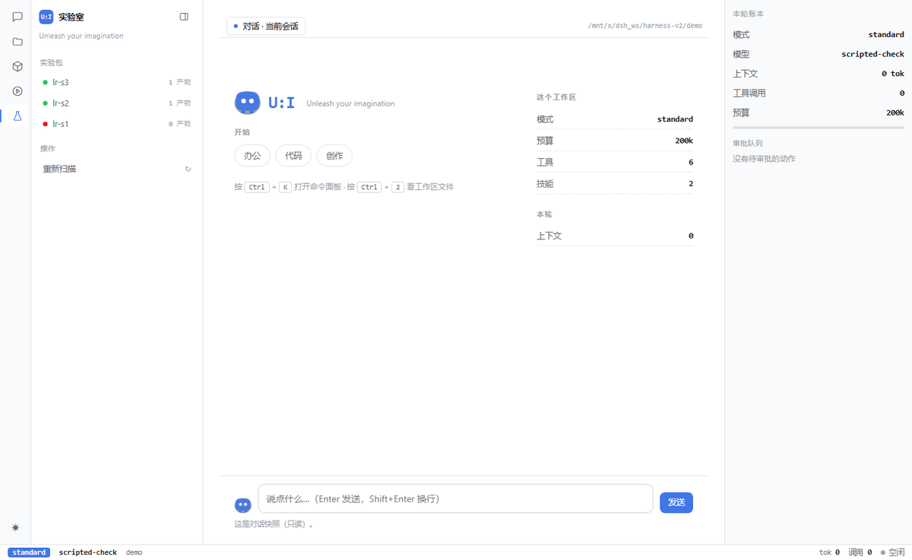
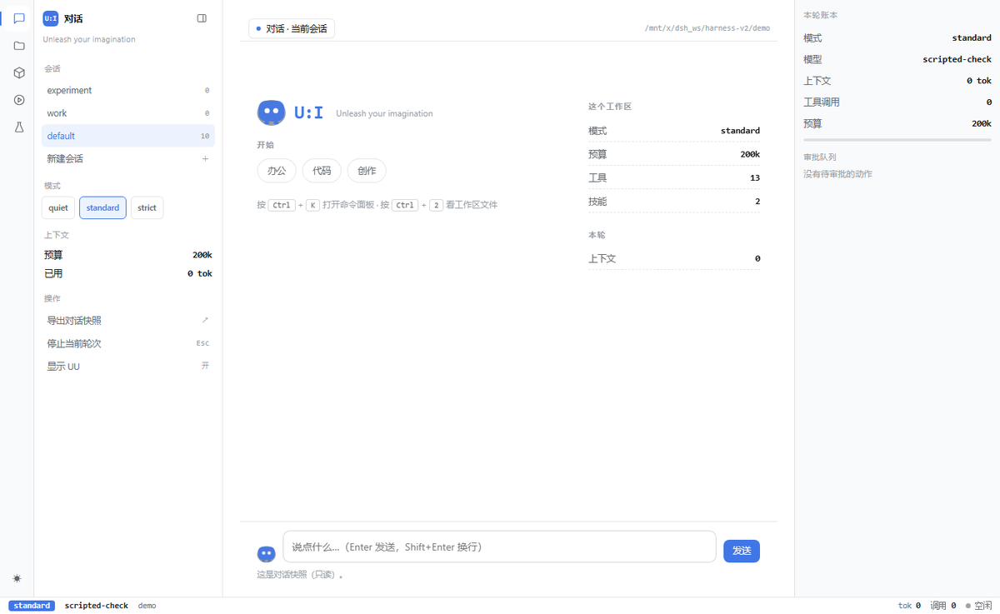

# ui

[](https://github.com/ProMetaDev/ui-harness/actions/workflows/ci.yml)

**把 agent 的每一步变成可审计的执行记录**：可校验、可回放、可崩溃对账。
Rust 内核，零第三方依赖，单二进制 1.9 MB。

---

## 它解决什么问题

大多数 coding agent 的日志是**调试输出**：出事之后才知道它做过什么，而且只能看它自己愿意说的部分。

`ui` 把日志当成**执行记录**：

| 你的处境 | 普通 agent | ui |
|---|---|---|
| "它到底改了哪些文件？" | 只有 tool 调用的摘要 | 精确到路径与哈希，`replay` 可查；shell 这类通道用 `effect/observed` 记录**实际改动** |
| "这个结论现在还成立吗？" | 无记录 | `ui lab verify` 逐条核对产物哈希、输入版本与结论 |
| "崩溃了，中间那步做完没有？" | 不知道 | 哈希链 + `ui resume` 对账未完成的调用 |
| "这条命令当时该不该放行？" | 只有当下的判断 | 三种模式的判定与日志格式解耦，`ui audit --as strict` 可以**事后重判**历史 |

## 30 秒上手

```bash
bash tools/bootstrap.sh   # 先看还缺什么（需要 Rust；其余逐项说明）
bash tools/test.sh        # 137 个测试
bash tools/debug.sh       # 39 项门禁：构建 + 端到端 + 攻击场景
```

```
$ ui --version
ui 0.1.2 (commit 9b4f84d, built 2026-11-16)
```

真实模型接上就能用（任何 OpenAI 兼容端点）：

```bash
# secrets/astra.json: {"base_url": "...", "api_key": "...", "model": "..."}
UI_MODEL_CMD="node tools/chat_compat.mjs" ui run --task "把 hello.txt 写出来" --yes
```

## 三个不一样的地方

**1. 日志是执行记录，不是调试输出。** 每行带 `prev`/`hash`，链可以**独立校验**：
`tools/verify_journal.py` 是 60 行 Python，不依赖 Rust 实现，格式只有两条规则。

**2. 信任边界被观测，而不是被声明。** shell 只声明"要执行这条命令"，内部行为声明里没有，
所以内核在它执行前后对比工作区，把实际改动写进日志：

```
$ ui replay
   4 14:05:14 tool/request       shell · ask · 执行命令
   7 14:05:14 tool/end           shell · ok
   8 14:05:14 effect/observed    shell · 实际改动 +1 ~0 -0 · 例 observed.txt
```

**3. 验证材料可以自己跑、自己破坏。**

```
$ bash tools/kit.sh
场景                     预期         实际               结论
1 删改日志             退出 2       py=2 ui=2          BLOCKED
2 截短尾部             py=3 ui=0    py=3 ui=0          REPAIRED
3 并发强杀             链完整/可修复 py=0               REPAIRED
4 符号链接逃逸         拒绝读取     被拒               BLOCKED
5 shell 间接读密钥     GAP（已知）  读到明文            GAP
6 插件漏报效果         GAP（已知）  写了文件无记录       GAP
7 验收失败             退出 3       code=3             BLOCKED
```

`GAP` 是**现在拦不住**的意思，我们不假装。详见 [docs/22](docs/22-verify-kit.md)。

## 界面

终端（`ui tui`）与网页（`ui serve`）共用同一套状态：同一个内核、同一份日志。


真实对话里每一次工具调用都带决策与结果（上图第三条是 shell 被批准后执行）。

| 实验室（`ui lab`） | 会话（多会话互不干扰） |
|---|---|
|  |  |

## 主要命令

| 命令 | 作用 |
|---|---|
| `ui doctor` | 探测真实环境能力，并打印信任边界 |
| `ui run --task "..."` | 跑一轮任务（`--mock` 可用剧本，无需模型） |
| `ui tui` / `ui serve` | 全屏终端 / 本地网页端 |
| `ui replay` | 回放日志：快照、计价、决策、副作用、**实际改动** |
| `ui verify` | 校验哈希链与未完成调用 |
| `ui resume` | 对账崩溃打断的副作用 |
| `ui audit --as strict` | 用另一个模式重判历史 |
| `ui team --task "..."` | 拆解 → 并行隔离 → 验收（默认不自动合并） |
| `ui lab pack/verify/table/claim` | 实验包：产物哈希、输入血统、多 seed 对照、结论对账 |
| `ui policy --effect K --target T` | 解释一条效果为什么被放行或拒绝 |

其余：`chat` / `workflow` / `apply` / `export` / `skills` / `preview` / `providers` / `sessions`。

## 诚实的边界

- **shell 是信任边界。** 批准一条命令，等于批准它内部的一切读写与联网；效果策略只决定
  "要不要执行这条命令"。所以多了 `effect/observed`——但那是**事后记账**，不是事前阻止。
- **没有 OS 级沙箱。** 防越权只能靠我们自己的策略，这挡不住决心要越界的东西。
- **插件声明不是强制约束。** `effects: []` 只表示"声称没有副作用"，内核不验证。
- **MCP 同理。** 外部 server 在自己的进程里自主运行。
- `effect/observed` 只看工作区内、只看元数据；大仓库可 `UI_OBSERVE=0` 关掉。

`ui doctor` 会把上面这段打在输出里，不让它藏在文档里。完整清单见 [SECURITY.md](SECURITY.md)。

## 验证方式

```bash
bash tools/kit.sh                        # 7 个攻击场景，一张结论表
python3 tools/verify_journal.py JOURNAL  # 0 完好 / 2 链被改 / 3 尾部残缺
UI_MODEL_CMD="node tools/chat_compat.mjs" bash tools/lab_real.sh   # 真模型 3 seeds 实验链路
```

- 格式说明与复跑记录模板：[docs/22-verify-kit.md](docs/22-verify-kit.md)
- 如果你跑出表外的结论，那比表内全部通过更有价值。
- **欢迎用这些材料挑毛病**：这个仓库的主要目的是被验证，不是被夸奖。

## 状态与许可

- v0.1.2 · **137 个测试** · **39 项门禁** · CI 在 Linux 与 Windows 交叉编译上每推必跑。
- 原型：能运行、有发布包（`bash tools/release.sh` 产出 tar.gz + sha256 并自解压校验），
  但**没有 OS 沙箱**，也没有经过第三方评审。
- 版本演进见 [CHANGELOG.md](CHANGELOG.md)；设计笔记在 [docs/](docs/)。
- 许可证：Apache-2.0。
