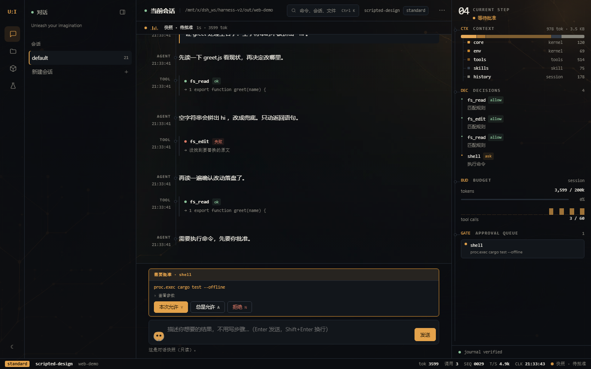
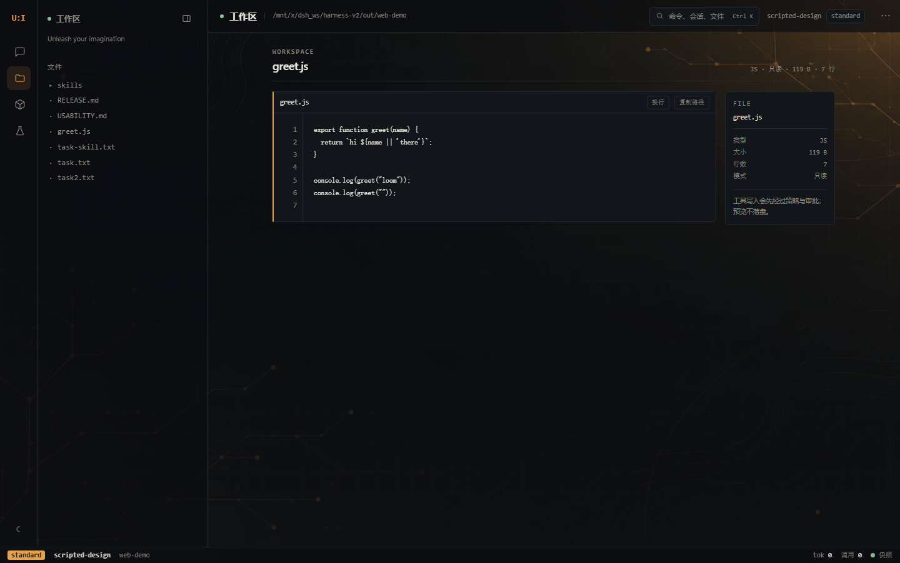
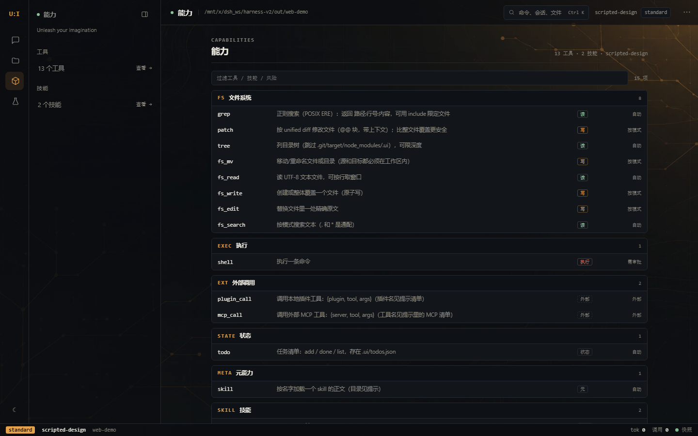
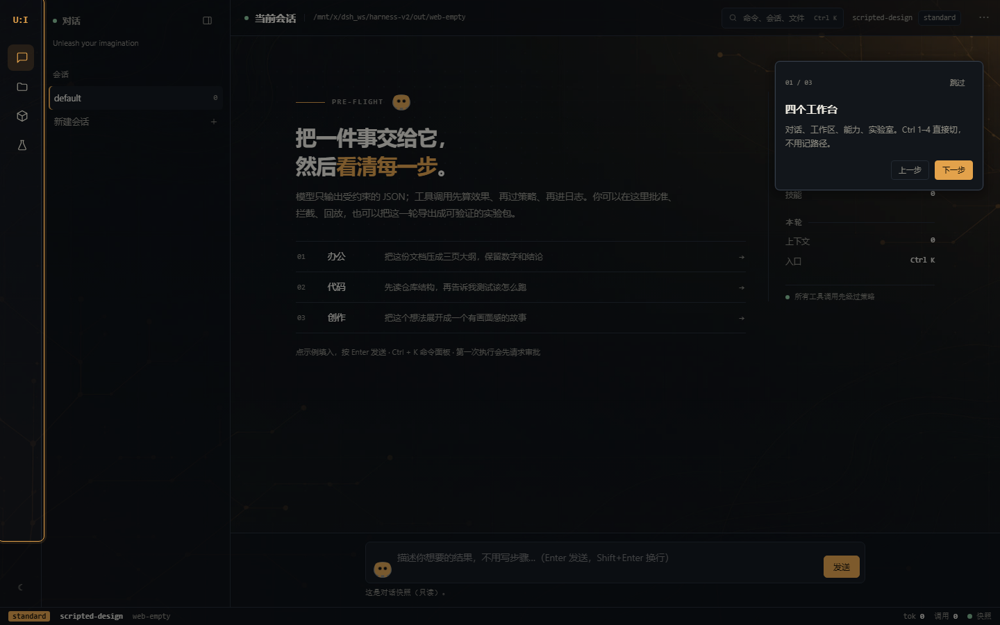
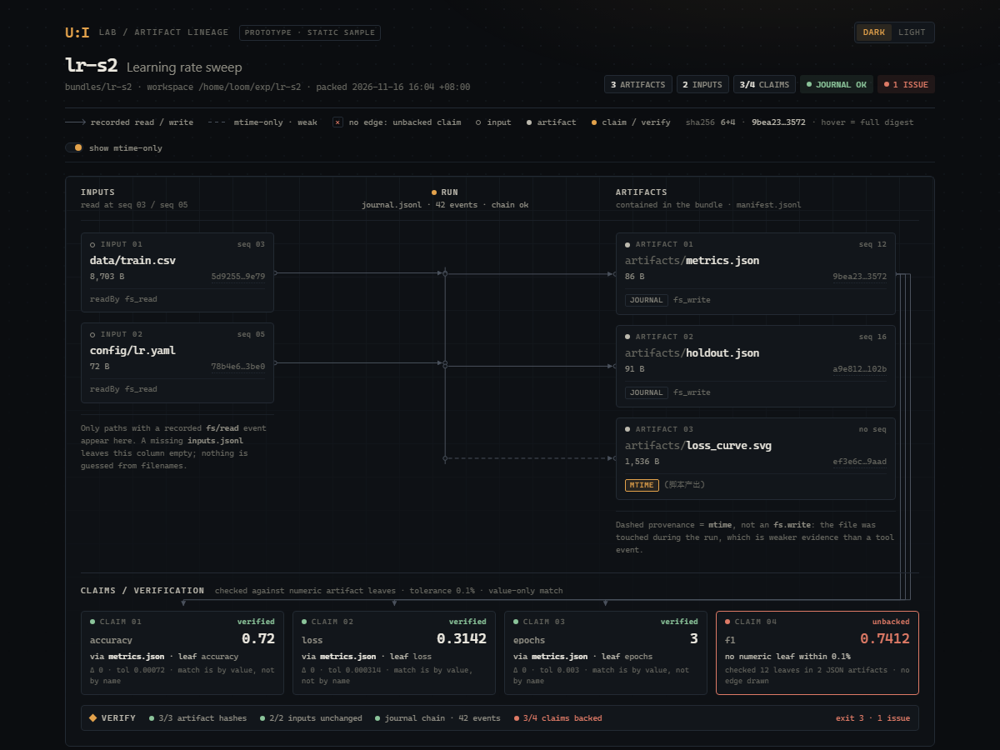

# ui

[](https://github.com/ProMetaDev/ui-harness/actions/workflows/ci.yml)

**把 agent 的每一步变成可审计的执行记录**：可校验、可回放、可崩溃对账。
Rust 内核，零第三方依赖；网页端、背景板、字体全部随单二进制走，不依赖 CDN。

---

> **当前版本 0.2.2：可用，但不是生产就绪。**
> 2026-11 的外部评审发现 2 个 P0 安全缺口与若干 P1 边界问题，**均已在 0.2.0 修复并有回归测试**
> （逐条回应见 [docs/33](docs/33-review-response.md)）。
> 我们**撤回了此前的 `v1.0.x` tag**：一个还没过外部评审、没有真实用户、没有多仓库评测的版本，
> 用 1.0 是给用户错误信号。版本号规则与 1.0 的准入条件见 [docs/34](docs/34-versioning.md)。

企业单租户的长期路线、Phase 0 架构和运维 runbook 在
[docs/35](docs/35-enterprise-roadmap.md) / [docs/36](docs/36-enterprise-phase0.md) /
[docs/37](docs/37-enterprise-runbook.md)。这些是**目标设计**，不是已交付的企业能力；
门禁只验证设计契约齐全，不把文档当成实现。

独立性约束见 [docs/38](docs/38-independence.md)：核心保持 Rust std-only，
不引入 Cursor/VS Code/云端/npm/CDN 依赖；企业能力只能作为可选 adapter。

变更审阅地基（checkpoint/diff/review/restore）见 [docs/39](docs/39-checkpoint-diff.md)。

零依赖代码索引见 [docs/40](docs/40-code-index.md)。

## 它解决什么问题

大多数 coding agent 的日志是**调试输出**：出事之后才知道它做过什么，而且只能看它自己愿意说的部分。

`ui` 把日志当成**执行记录**：

| 你的处境 | 普通 agent | ui |
|---|---|---|
| "它到底改了哪些文件？" | 只有 tool 调用的摘要 | 精确到路径与哈希，`replay` 可查；shell 这类通道用 `effect/observed` 记录**实际改动** |
| "这个结论现在还成立吗？" | 无记录 | `ui lab verify` 逐条核对产物哈希、输入版本与结论 |
| "崩溃了，中间那步做完没有？" | 不知道 | 哈希链 + `ui resume` 对账未完成的调用 |
| "这条命令当时该不该放行？" | 只有当下的判断 | 三种模式的判定与日志格式解耦，`ui audit --as strict` 可以**事后重判**历史 |

## 30 秒上手

想先**看效果**再决定要不要装？不用 Rust、不用模型，30 秒：

```bash
bash tools/demo-audit.sh   # 跑一轮 → 回放 → 校验 → 篡改 → 发现 → 修复
```

完整解说（真实输出逐步注释）：[docs/quickstart.md](docs/quickstart.md)

装好了再跑这些：

```bash
bash tools/bootstrap.sh   # 先看还缺什么（需要 Rust；其余逐项说明）
bash tools/test.sh        # 全量测试（数量以脚本输出为准）
bash tools/debug.sh       # 门禁：构建 + 端到端 + 攻击场景 + 跨平台（项数以脚本输出为准）
```

```
$ ui --version
ui 0.2.2 (commit 0000000, built 2026-11-20)
```

网页端（四个工作台：对话 / 工作区 / 能力 / 实验室）：

```bash
cargo build --release
./target/release/ui serve --workspace . --port 7788
# 打开终端打印的 http://127.0.0.1:7788/?t=…
```

真实模型接上就能用（任何 OpenAI 兼容端点）：

```bash
# secrets/astra.json: {"base_url": "...", "api_key": "...", "model": "..."}
UI_MODEL_CMD="node tools/chat_compat.mjs" ui run --task "把 hello.txt 写出来" --yes
```

## 四个不一样的地方

**1. 日志是执行记录，不是调试输出。** 每行带 `prev`/`hash`，链可以**独立校验**：
`tools/verify_journal.py` 是 60 行 Python，不依赖 Rust 实现，格式只有两条规则。

**2. 信任边界被观测，而不是被声明。** shell 只声明"要执行这条命令"，内部行为声明里没有，
所以内核在它执行前后对比工作区，把实际改动写进日志：

```
$ ui replay
   4 14:05:14 tool/request       shell · ask · 执行命令
   7 14:05:14 tool/end           shell · ok
   8 14:05:14 effect/observed    shell · 实际改动 +1 ~0 -0 · 例 observed.txt
```

**3. 验证材料可以自己跑、自己破坏。**

```
$ bash tools/kit.sh
场景                     预期         实际               结论
1 删改日志             退出 2       py=2 ui=2          BLOCKED
2 截短尾部             py=3 ui=0    py=3 ui=0          REPAIRED
3 并发强杀             链完整/可修复 py=0               REPAIRED
4 符号链接逃逸         拒绝读取     被拒               BLOCKED
5 shell 间接读密钥     GAP（拦不住） 读到明文（日志已抹）  GAP
6 插件漏报效果         GAP（拦不住） 写了·观测已入日志     GAP
7 验收失败             退出 3       code=3             BLOCKED
8 shell 写工作区外     被拒         被拒               BLOCKED
```

上表只是一次运行的片段（当前是 12 个场景）；场景数以 `bash tools/kit.sh` 的实际输出为准。
`GAP` 是**现在拦不住**的意思，我们不假装。详见 [docs/22](docs/22-verify-kit.md)。

两行 GAP 的**范围**要读准，别把它们读成"什么都没做"：
场景 5 测的是**上下文里仍然是明文**（沙箱不限读，这一半没补）。
日志那一半现在由落账前的脱敏门兜着——同一条命令的输出进日志时会是
`[REDACTED:api_key]`，命中隐私清单时整段不进日志、只留字数与指纹。

**4. 知识与记忆是证据，不是黑箱。** 知识卡绑定它描述的那份源码，记忆的每次注入都留痕：

```
$ ui replay
   1 knowledge/use   卡片 mod-pay · path-match:src/pay/x.rs · 15 tok
   2 turn/start      ## 预取的知识卡 … 先锁单后打款。 任务：把退款改成两步确认
   3 memory/used     记忆 m-3f9a1c… · keyword-match:门禁 · 12 tok
```

- 卡片改了源码就不一致：`ui knowledge check` 打印 `STALE` 并退出 2（`--strict` 连"未绑定"也算红）。
- 记忆只有**人**能写（`ui remember`），注入哪条、为什么命中，都进日志；`ui memory check` 校验记忆链。
- 网页端（`ui serve`）同样能看到这些行——它们走同一条 SSE，不是给 CLI 的专属信息。

我们**没有**做向量检索、没有自动生成规范：这两件事都无法被 `verify` 证伪。

## 界面

终端（`ui tui`）与网页（`ui serve`）共用同一套状态：同一个内核、同一份日志、同一套策略。

网页的聊天流有**离线**校验：`tools/check_chat_stream.mjs` 用假 DOM + 假 EventSource
跑一遍 `chat.html` 的脚本，断言气泡合并、turn 状态、草稿保留与转义（不需要浏览器/网络）。



网页端不是“聊天页加几个侧栏”，而是四个工作台：

| 对话 / step trace | 工作区 |
|---|---|
| 日志、决策、审批、`+41ms` 耗时、遥测状态栏 | 文件树 + 只读预览 + 行号 + 复制/换行 |
|  |  |

| 能力矩阵 | 实验室 |
|---|---|
| 文件 / 执行 / 外部 / 状态 / 元五组，effect + 审批门 + 搜索 | 实验包、报告、空/错/加载三态 |
|  |  |

首开有 3 步教练，工作区 / 能力 / 实验室各有一次性上下文提示；`?` 或 `⋯ → 重新看引导` 可重开。



设计约束（配色、树结构、动效、背景板）在 [docs/03-frontend.md](docs/03-frontend.md)；
文档安全编辑 skill 在 [demo/skills/doc-safe-edit/SKILL.md](demo/skills/doc-safe-edit/SKILL.md)，
Word 专用方案与脚本在 [demo/skills/docx-safe-edit/SKILL.md](demo/skills/docx-safe-edit/SKILL.md)，
技术调研在 [docs/32-doc-safe-edit-skill.md](docs/32-doc-safe-edit-skill.md) / [docs/33-docx-safe-edit.md](docs/33-docx-safe-edit.md)；
实验室血缘 DAG 的独立原型在 [design/lab-lineage.html](design/lab-lineage.html)，目前是静态样例，未接生产数据：



## 主要命令

| 命令 | 作用 |
|---|---|
| `ui doctor` | 探测真实环境能力，并打印信任边界 |
| `ui run --task "..."` | 跑一轮任务（`--mock` 可用剧本，无需模型） |
| `ui tui` / `ui serve` | 全屏终端 / 本地网页端 |
| `ui replay` | 回放日志：快照、计价、决策、副作用、**实际改动** |
| `ui verify` | 校验哈希链与未完成调用 |
| `ui resume` | 对账崩溃打断的副作用 |
| `ui audit --as strict` | 用另一个模式重判历史 |
| `ui team --task "..."` | 拆解 → 并行隔离 → 验收（默认不自动合并） |
| `ui lab pack/verify/table/claim` | 实验包：产物哈希、输入血统、多 seed 对照、结论对账 |
| `ui policy --effect K --target T` | 解释一条效果为什么被放行或拒绝 |
| `ui spill [clean]` | 看/清落在磁盘上的工具输出原文（两个目录、一份保留预算） |
| `ui secrets` | 扫留在 `.ui` 里的明文：日志、两个落盘目录、记忆库 |

其余：`chat` / `workflow` / `apply` / `export` / `skills` / `preview` / `providers` / `sessions`。

## 诚实的边界

- **shell 是信任边界，但 Linux 上有沙箱。** 批准一条命令，等于批准它内部的一切行为；
  所以两件事一起做：`effect/observed` 记**实际改动**（事后），Landlock 把**写入**限制在工作区
  与 /tmp（事前）。内核不支持时**命令直接失败**，不会偷偷降级成无沙箱执行（`UI_SANDBOX=0` 可显式关闭）。
- **Windows 上没有文件写入隔离。** 但有 Job Object：进程树由内核强制回收、内存与进程数有上限，
  命令正常结束时也会连同后台子进程一起收掉（`start /b` 留下的孤儿不会活过命令）。
- **插件声明不是强制约束。** `effects: []` 只表示"声称没有副作用"，内核不验证。
- **MCP 同理。** 外部 server 在自己的进程里自主运行。
- **隐私两档管的是日志，不是上下文。** 落账前默认脱敏（`--no-redact` 可关，会留
  `privacy/redact-off` 记录）；`--private PATH` 让命中来源的输出整段不进上下文、不进日志，
  原文落在模型**读不到**的 `.ui/tool-private/`。落盘原文按保留期自动清（`ui spill`）。
  但脱敏是模式匹配、不是 DLP，而且**网页端看到的是原文**——见 [SECURITY.md](SECURITY.md)。
- `effect/observed` 只看工作区内、只看元数据；大仓库可 `UI_OBSERVE=0` 关掉。

`ui doctor` 会把上面这段打在输出里，不让它藏在文档里。完整清单见 [SECURITY.md](SECURITY.md)。

**校验能证明"自洽"，不能证明"真实"。** 哈希链挡得住随手改和崩溃撕裂，
但挡不住"改完把后面的哈希重算一遍"——那样会得到另一条合法链（`tools/demo_rewrite_chain.py` 是实证）。
要跨过这条线需要日志之外的对账点（打包时记录头部哈希），这是 v1.1 的待办 V1。

## 验证方式

```bash
bash tools/kit.sh                        # 攻击场景，一张结论表（场景数以输出为准）
python3 tools/verify_journal.py JOURNAL  # 0 完好 / 2 链被改 / 3 尾部残缺
UI_MODEL_CMD="node tools/chat_compat.mjs" bash tools/lab_real.sh   # 真模型 3 seeds 实验链路
```

- 格式说明与复跑记录模板：[docs/22-verify-kit.md](docs/22-verify-kit.md)
- 如果你跑出表外的结论，那比表内全部通过更有价值。
- **欢迎用这些材料挑毛病**：这个仓库的主要目的是被验证，不是被夸奖。

## 状态与许可

- **0.2.2** · 测试与门禁由 `bash tools/test.sh` / `bash tools/debug.sh` 实跑给出 · CI 在 Linux 与 Windows 交叉编译上每推必跑。
- 原型：能运行、有发布包（`bash tools/release.sh` 产出 tar.gz + sha256 并自解压校验）。
  Linux 有 Landlock（写入限制在工作区与 /tmp），Windows 有 Job Object（进程树/内存/进程数上限），
  但 **Windows 没有文件写入隔离**；整体尚未经过第三方评审。
- 版本演进见 [CHANGELOG.md](CHANGELOG.md)；设计笔记在 [docs/](docs/)。
- 许可证：Apache-2.0。
